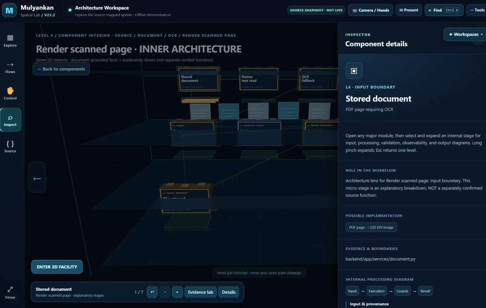
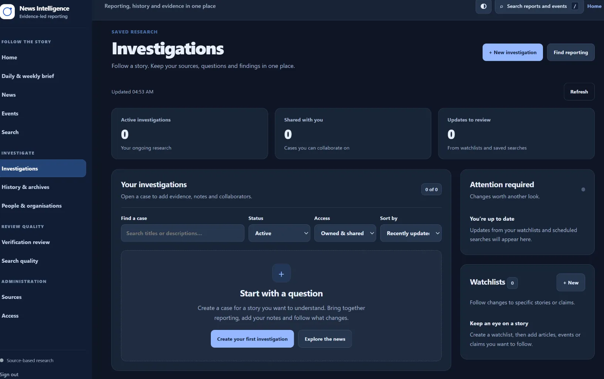
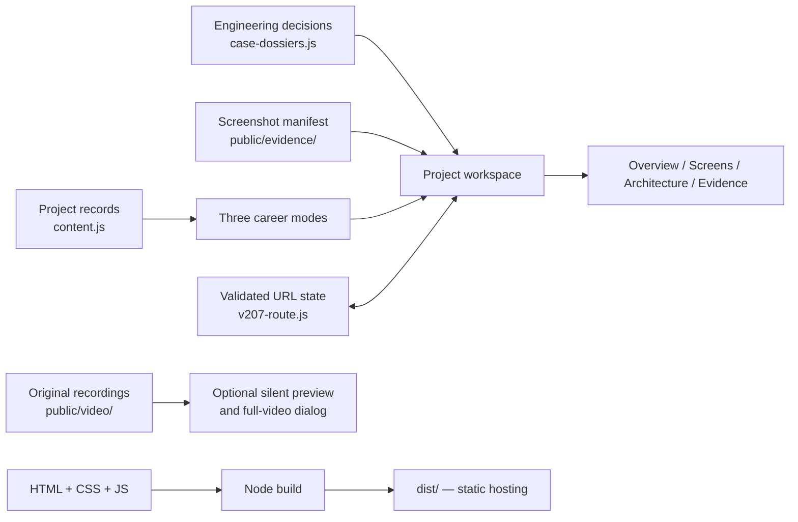

# Inside the Builder's Mind

**An interactive, evidence-first engineering portfolio**

A single website presenting three professional perspectives—**Full-Stack**, **Software Systems**, and **Applied ML**—through genuine project captures, inspectable architecture, design decisions, source references, and clearly stated validation limits.

[**Explore the latest verified preview**](https://inside-the-builders-mind-fvahtlv7c.vercel.app/) · [Architecture](docs/architecture/README.md) · [Run locally](#run-locally) · [AWS deployment status](AWS_DEPLOYMENT.md) · [CI checks](https://github.com/himanshu051116/inside-the-builders-mind/actions/workflows/ci.yml)


> **Release note:** The link above is a tested **V25.5 preview**, not proof of an AWS deployment. The default `main` branch and the portfolio's production deployment may follow different release schedules. This repository is maintained with feature branches and a separate AWS deployment candidate.

## What makes it different

- **Role-specific exploration:** Three career views, each with a corresponding public résumé and relevant project ordering.
- **Real interfaces and traceable evidence:** Original screenshots, source links, engineering case records, and recorded demonstrations—with uncertainty made explicit.
- **Interactive technical inspection:** Project-specific Overview, Screens, Architecture, and Evidence tabs; deep links to stages and captures; a local evidence-review workbench.
- **Intentional interaction:** Hover previews can be cancelled or committed. The ten-section archive opens by click/keyboard, never accidental scrolling; a compact Close control stays reachable.
- **Preserved original media:** The Mulyankan recording offers an optional muted in-view excerpt and an explicitly started full recording with its original audio.
- **Static and inspectable:** Plain JavaScript, HTML, CSS and Node.js build scripts, without a production API or server runtime required to serve this portfolio.

## Featured work

| Project | Engineering focus | Current status | Evidence |
| --- | --- | --- | --- |
| [Mulyankan](https://github.com/himanshu051116/Algonauts-Mulyankan) | Document review, scoring transparency, rubric/evidence traceability | **Demonstrated prototype** | [Original interface capture](public/evidence/mulyankan-overview.webp) |
| [NewsSources](https://github.com/himanshu051116/NewsSources) | Article ingestion, PostgreSQL frontier coordination and failure handling | **In development** | [Original interface capture](public/evidence/news-overview.webp) |
| [Our Hidden Universe](https://github.com/himanshu051116/our-hidden-universe) | React/Firebase private collaboration and shared-session interfaces | **Deployed application** | [Original interface capture](public/evidence/ohs-home.webp) |
| [EarthBridge](https://github.com/himanshu051116/earthbridge) | PyTorch/FAISS cross-sensor satellite-retrieval experiments | **Research prototype** | [Original interface capture](public/evidence/earthbridge-workbench.webp) |
| [SchoolBuddies](https://github.com/himanshu051116/SCHOOLBUDDIES) | Student-led school technology outreach | **Live website / community initiative** | [Workshop capture](public/evidence/schoolbuddies-workshop.webp) |

### Screenshots from the actual projects

| Mulyankan — spatial inspection | NewsSources — investigation interface |
|:---:|:---:|
|  |  |

These are preserved source captures, **not generated mockups**. Screenshots document visible interface states; they do not independently prove uptime, model accuracy, production load capacity or security.

## Engineering architecture



The real implementation retains versioned styling and interaction modules for backwards compatibility. The build combines ordered source styles into one production stylesheet and copies the static assets into `dist/`. See the [architecture notes](docs/architecture/README.md) for ownership and limitations.

## Run locally

**Requirements:** Node.js **22+**, npm and Git. No third-party application runtime packages or credentials are required to run the portfolio.

```bash
git clone https://github.com/himanshu051116/inside-the-builders-mind.git
cd inside-the-builders-mind

npm run dev      # local development server
npm run verify   # build + automated tests + local/metadata audits
npm run preview  # inspect the generated dist/ build
```

Use `npm run build` to rebuild `dist/` without running all checks. Generated files are ignored by Git. The source branch containing this README may not yet have been merged into `main`; use the branch selector to obtain the current candidate.

## Quality and evidence boundaries

`npm run verify` runs the Node test suite, the static build, the local content audit, and the metadata audit. GitHub Actions executes the same checks; [testing documentation](docs/testing/README.md) explains what those tests do **and do not** establish.

The optional evidence-review workbench and selected interactive project tours use **local, deterministic sample data**. The EarthBridge demonstration includes illustrative/synthetic retrieval examples; it is **not** live trained-model inference. OHS screenshots and sample conversations are not evidence of real private user communications. Source-linked evaluation claims are not independently reproduced by this portfolio.

No visitor authentication, backend database service, or live AI inference is required to operate this portfolio.

## Hosting

| Environment | Status |
| --- | --- |
| [Verified V25.5 Vercel preview](https://inside-the-builders-mind-fvahtlv7c.vercel.app/) | Preview available; not the same as production |
| AWS Amplify | **Not deployed.** Connected AWS account currently blocks Amplify and S3 bucket creation via organization policy |
| Custom AWS domain | Not configured |

For deployment instructions and account-policy constraints, consult [AWS_DEPLOYMENT.md](AWS_DEPLOYMENT.md). Canonical URLs, social preview links, and the sitemap currently reference the Vercel host and must be reviewed **after** an AWS domain is verified—never changed in anticipation of a deployment.

## Repository guide

| Resource | Purpose |
| --- | --- |
| [Architecture](docs/architecture/README.md) | Module boundaries, state ownership and data provenance |
| [Testing](docs/testing/README.md) | Test commands, coverage limits and release checklist |
| [Deployment](docs/deployment/README.md) | Build artifact and hosting options |
| [Changelog](CHANGELOG.md) | Current release progression and verification boundaries |
| [Historical reports](docs/history/README.md) | Archived development notes and audits |
| [Contributing](CONTRIBUTING.md) | Development and review expectations |
| [Licensing guidance](docs/LICENSING.md) | Current reuse and third-party asset status |

## Maintainer and attribution

Built and maintained by [Himanshu Shukla](https://github.com/himanshu051116), Mathematics & Computing undergraduate at MITS Gwalior. This repository documents the **portfolio website**; linked applications and research projects remain separate codebases with their own boundaries and licenses.

**License:** No open-source license has been selected for this repository. See [licensing guidance](docs/LICENSING.md) before copying or redistributing any code, personal material, screenshot or video.
